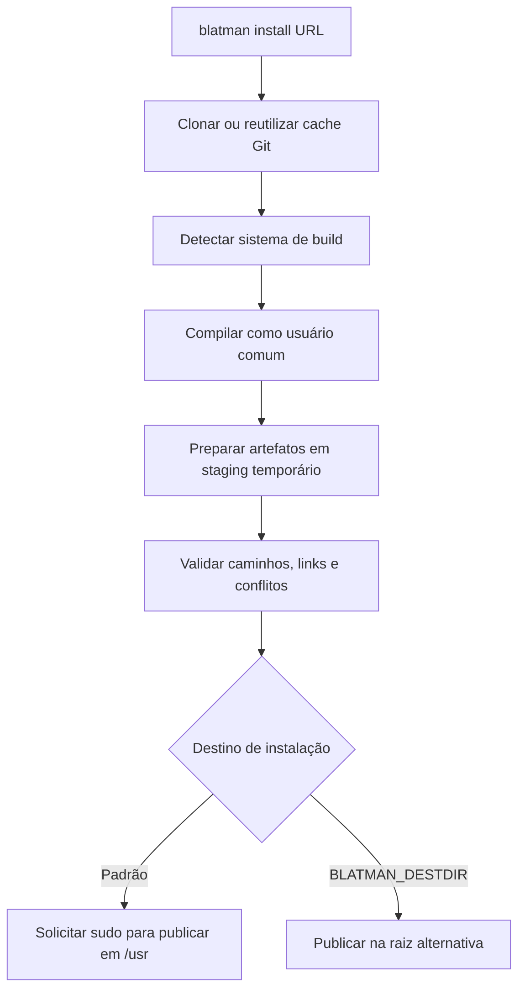

<div align="center">

# ⚡ Blatman

**Do código-fonte à instalação, sem precisar decorar um comando para cada sistema de build.**

Um gerenciador de compilação e instalação para Linux, escrito em **C++20**. O Blatman identifica o sistema de build de um projeto, coordena a compilação e prepara os arquivos antes de publicá-los no destino final.


[Começar](#começando) · [Funcionalidades](#funcionalidades) · [Compatibilidade](#sistemas-de-build) · [Java e memória](#java-e-uso-de-memória) · [Roadmap](#roadmap)

</div>

---

## Por que o Blatman?

Um projeto usa CMake. Outro usa Cargo. O seguinte depende de Maven, Gradle ou Meson. Compilar cada um à mão exige conhecer ferramentas, argumentos e etapas de instalação diferentes.

O **Blatman** nasceu para oferecer **um fluxo consistente** sobre essas ferramentas — sem tentar substituir seus compiladores, gerenciadores de dependências ou sistemas de build.

```bash
blatman build .
blatman install https://github.com/apache/commons-codec.git
```

> [!IMPORTANT]
> **Projeto em desenvolvimento.** `build` e `install` são os fluxos implementados. `remove` e `update` ainda **não funcionam**. O Blatman ainda não é um substituto completo de `pacman`, `apt`, `dnf` ou de outros gerenciadores de pacotes.

## Funcionalidades

- **Detecção de nove sistemas de build**, com opção de escolha explícita quando há mais de um manifesto.
- **Build local** por uma interface única (`blatman build <diretório>`).
- **Instalação a partir de repositórios Git HTTPS** no formato `https://host/autor/repositório.git`.
- **Reutilização de clones em cache**, evitando baixar novamente um repositório que já está presente.
- **Staging de instalação**: os artefatos são preparados numa árvore temporária antes de chegar ao sistema.
- **Validação de destinos, conflitos e links simbólicos**, com tentativa de rollback dos arquivos criados caso a publicação falhe.
- **Resolução interativa de dependências ausentes** a partir de alguns diagnósticos de erro, por pacote da distribuição ou outra URL Git.
- **Suporte a Java com seleção de JDK**, Maven e Gradle, incluindo um perfil de memória econômico por padrão.
- **Separação de privilégios**: o build roda como usuário comum; apenas a publicação em `/usr` solicita `sudo`.

## Começando

### Requisitos

- **Linux** e ferramentas de desenvolvimento C/C++ compatíveis com **C++20**.
- **CMake 3.20+**, **Git** e **nlohmann_json 3.6+** (necessário na compilação do Blatman).
- Um compilador C++ e as ferramentas correspondentes ao projeto que será construído (por exemplo: `make`, `meson`/`ninja`, `cargo`, `go`, `npm`, `mvn` ou `gradle`).
- **JDK instalado** para projetos Java. O Blatman seleciona uma instalação compatível, mas não instala JDKs automaticamente.
- **Python 3** para executar os testes de regressão opcionais.

No Arch Linux, as dependências **para compilar o próprio Blatman** podem ser instaladas com:

```bash
sudo pacman -S --needed base-devel cmake git nlohmann-json
```

> As dependências de cada projeto continuam sendo responsabilidade de seu ecossistema. Maven, Gradle, Cargo, Go e npm não são instalados automaticamente por esse comando.

### Compilar e instalar o Blatman

```bash
git clone https://github.com/Blatokkj/blatman.git
cd blatman

cmake -S . -B build \
  -DCMAKE_BUILD_TYPE=Release \
  -DCMAKE_INSTALL_PREFIX=/usr \
  -DBUILD_TESTING=OFF

cmake --build build -j2
sudo cmake --install build

blatman help
```

Por padrão, a configuração CMake do projeto utiliza `/usr` como prefixo; o executável é instalado em **`/usr/bin/blatman`**. O `-j2` acima é uma escolha conservadora para máquinas com pouca memória, e pode ser ajustado.

Para conferir qual binário está sendo executado:

```bash
type -a blatman
```

## Uso

### Compilar um projeto local

```bash
cd /caminho/do/projeto
blatman build .
```

O Blatman detecta o sistema de build a partir dos arquivos presentes na pasta e invoca a ferramenta correspondente. **Build não significa instalação**: `build` não publica arquivos no sistema.

### Clonar, compilar e instalar

```bash
blatman install https://github.com/apache/commons-codec.git
```

Esse fluxo clona (ou reutiliza) o repositório, detecta o sistema de build, executa a compilação, prepara os artefatos e tenta publicá-los sob `/usr`. Quando a publicação exige privilégios, o Blatman solicita `sudo` apenas na etapa final.

**Teste sem instalar em `/usr`:**

```bash
BLATMAN_DESTDIR="$HOME/blatman-test-root" \
  blatman install https://github.com/apache/commons-codec.git
```

Nesse modo, a estrutura `usr/` é criada dentro de `~/blatman-test-root`, sem exigir `sudo` para publicar ali. É útil para inspecionar os artefatos antes de usar o destino do sistema.

### Comandos disponíveis

| Comando | Estado | Descrição |
| --- | --- | --- |
| `blatman build <diretório>` | ✅ Implementado | Compila um projeto local. |
| `blatman install <URL HTTPS>` | ✅ Implementado | Clona/reutiliza, compila e prepara a instalação. |
| `blatman help` | ✅ Implementado | Exibe a ajuda resumida. |
| `blatman remove` | 🚧 Pendente | Ainda não remove pacotes instalados. |
| `blatman update` | 🚧 Pendente | Ainda não atualiza pacotes instalados. |

Atalhos reconhecidos: `-B`/`-b` para build, `-S`/`-i` para install, `-h`/`--help` para ajuda, `-R`/`-r` para remove e `-U`/`-u` para update. **Os atalhos de comandos pendentes também permanecem pendentes.**

## Sistemas de build

O Blatman identifica os sistemas abaixo e possui fluxos de build e preparação de instalação para eles. Isso **não garante** que qualquer projeto desses ecossistemas possa ser instalado: é necessário que a estrutura e as receitas do projeto sejam compatíveis.

| Sistema | Identificação típica | Comportamento principal |
| --- | --- | --- |
| **CMake** | `CMakeLists.txt` | Configura/compila via CMake; usa `cmake --install` com `DESTDIR` no staging. |
| **Make** | `Makefile`, `makefile`, `GNUmakefile` | Executa `make`; procura alvo `install` ou um executável ELF reconhecido. |
| **Meson** | `meson.build` | Configura/compila e prepara via `meson install`. |
| **Cargo (Rust)** | `Cargo.toml` | Consulta os metadados do workspace e seleciona executáveis produzidos. |
| **Go** | `go.mod` ou `go.work` | Descobre pacotes e prepara executáveis Go. |
| **npm** | `package.json` | Instala dependências, executa build e prepara pacote npm em staging. |
| **Maven** | `pom.xml` | Executa `package` e publica artefatos num repositório Maven local de staging. |
| **Gradle** | `build.gradle[.kts]`, `settings.gradle[.kts]` | Executa build; prepara publicações Maven e distribuições de aplicativos reconhecidas. |
| **Autotools** | `configure`, `configure.ac`, `configure.in` | Configura/compila e utiliza o fluxo de instalação baseado em Make. |

Se vários sistemas coexistirem no mesmo repositório, use uma escolha explícita:

```bash
BLATMAN_BUILD_SYSTEM=cmake blatman build .
```

As opções aceitas são `cmake`, `make`, `meson`, `cargo`, `go`, `npm`, `maven`, `gradle` e `autotools`.

## Java e uso de memória

O suporte a Java é pensado também para computadores com recursos limitados. Sem configurar nada, o Blatman utiliza um **perfil econômico** para as ferramentas Java que invoca:

| Parâmetro | Padrão |
| --- | --- |
| Heap inicial da JVM configurada | `64 MiB` (`-Xms64m`) |
| Heap máximo da JVM configurada | `512 MiB` (`-Xmx512m`) |
| Metaspace máximo da JVM configurada | `384 MiB` |
| Coletor de lixo | `SerialGC` |
| Workers do Gradle | `1` |
| Paralelismo entre projetos no Gradle | Desativado (`--no-parallel`) |
| Daemon persistente do Gradle | Desativado (`--no-daemon`) |
| Histórico de saída Java retido pelo Blatman | Até `256 KiB` nas chamadas configuradas |

**Uso normal:**

```bash
blatman build .
```

Para projetos que precisem de mais recursos, os limites podem ser **sobrescritos apenas naquela execução**:

```bash
BLATMAN_JAVA_HEAP_MB=1024 BLATMAN_JAVA_WORKERS=2 blatman build .
```

- `BLATMAN_JAVA_HEAP_MB`: inteiro entre **256 e 32768**; padrão `512`.
- `BLATMAN_JAVA_WORKERS`: inteiro entre **1 e 32**; padrão `1` (afeta Gradle).
- `BLATMAN_JAVA_HOME`: seleciona explicitamente o diretório de um JDK compatível.

Para Gradle, o Blatman verifica a versão e escolhe um JDK compatível entre instalações encontradas; wrappers `gradlew` e `mvnw` têm prioridade quando disponíveis. A obtenção automática de JDK pelo Gradle é desativada. A compilação Kotlin é solicitada **in-process** no Gradle.

> [!NOTE]
> `-Xmx512m` limita o **heap** da JVM configurada, **não a RAM total** do Maven, Gradle ou de processos filhos. Projetos maiores podem precisar de mais memória; o perfil padrão prioriza previsibilidade em vez de desempenho máximo.

### Validação manual: Apache Commons Codec

Em **20/10/2026**, o fluxo `blatman install https://github.com/apache/commons-codec.git` concluiu a compilação, os testes e a etapa de instalação no ambiente de desenvolvimento do projeto:

- **19.856 testes executados**; **0 falhas**, **0 erros** e **7 ignorados**, conforme a saída do Maven.
- JDK 27 selecionado e opções de heap de `512 MiB` aplicadas ao Maven.
- JARs e artefatos Maven produzidos e publicados em staging antes da instalação final.
- Num notebook com **4 GB de RAM**, foi observada uma leitura de cerca de **2,73 GB de RAM utilizada** durante o processo.

É **um teste manual específico**, não um benchmark reproduzível, uma medição de pico ou uma promessa de compatibilidade com qualquer projeto Java.

## Como funciona a instalação



A etapa de publicação verifica tipos de arquivos, rejeita destinos fora da árvore `usr/`, recusa conflitos já existentes e valida links simbólicos. Se uma cópia falhar, tenta desfazer os arquivos criados pela operação.

Essas verificações **não tornam seguro executar código-fonte desconhecido**: scripts de build, plugins e dependências podem executar código durante a compilação. Revise a procedência do projeto antes de instalar.

### Cache Git

Os clones ficam em **`./blatman-cache/`**, relativo ao diretório a partir do qual o Blatman foi executado. O cache permite reutilizar um checkout, mas **não executa automaticamente `git pull` ou `git fetch`** para atualizá-lo.

## Testes e desenvolvimento

O CMake permite compilar a suíte de regressão separadamente:

```bash
cmake -S . -B build \
  -DCMAKE_BUILD_TYPE=Debug \
  -DBUILD_TESTING=ON
cmake --build build -j2
ctest --test-dir build --output-on-failure
```

A suíte registrada no CTest cobre fluxos de instalação/publicação e verificações offline. Há também scripts específicos para os sistemas de build:

```bash
python3 tests/build-system/detector.py
python3 tests/build-system/integration.py
```

Esses scripts precisam de suas ferramentas externas correspondentes (como compilador C++, **Cargo** e **Go**), e atualmente são executados **separadamente** do CTest. Alguns testes geram arquivos e logs temporários no diretório de testes.

### Organização do código

```text
blatman/
├── include/                 # Interfaces públicas internas dos módulos
│   └── operations/          # Contratos dos comandos
├── src/
│   ├── operations/          # build, install, help, remove, update
│   ├── builderDetector.cpp  # Identificação dos sistemas de build
│   ├── javaSupport.cpp      # Maven, Gradle, JDK e limites de memória
│   ├── projectWorkflow.cpp  # Fluxo de build e instalação
│   ├── nativeInstall.cpp    # Preparação dos artefatos em staging
│   ├── installTransaction.cpp # Validação e publicação no destino
│   └── shell.cpp            # Execução e captura dos comandos externos
├── tests/                   # Regressão e testes de integração
└── CMakeLists.txt
```

## Limitações conhecidas

1. **`remove` e `update` ainda não estão implementados.** Não existe, nesta fase, uma base completa de pacotes instalados com operações de desinstalação/atualização.
2. **Clones em cache não são atualizados automaticamente.** Reutilizar um cache pode significar compilar uma revisão anterior do repositório.
3. **Instalação não é sinônimo de build.** Projetos sem receita de instalação compatível podem compilar corretamente e mesmo assim não produzir artefatos instaláveis.
4. **Publicação em `/usr` evita conflitos em vez de sobrescrever arquivos existentes.** Uma reinstalação pode ser recusada se os caminhos de destino já estiverem ocupados.
5. **Resolução de dependências é assistida e parcial.** O Blatman reconhece determinados padrões de erros; não resolve automaticamente toda dependência possível.
6. **O alvo atual é Linux.** Não há suporte declarado para Windows ou macOS, nem garantia de compatibilidade com toda distribuição Linux.

## Roadmap

- [x] Interface única para build e instalação a partir de Git
- [x] Detecção de nove sistemas de build
- [x] Preparação e validação de artefatos antes da publicação
- [x] Suporte a Maven/Gradle com perfil econômico de memória
- [x] Testes de regressão e integração
- [ ] Registro e rastreamento dos pacotes instalados
- [ ] Implementar `remove`
- [ ] Implementar `update` (incluindo atualização seletiva)
- [ ] Melhorar a atualização e a política de cache de repositórios
- [ ] Reduzir builds Java redundantes e aprimorar o cache Maven
- [ ] Expandir a suíte automatizada e integrá-la continuamente ao CI
- [ ] Aprimorar o gerenciamento adaptativo de recursos conforme a memória disponível

## Contribuição e feedback

O Blatman é um projeto em evolução. Relatos de problemas devem incluir o comando executado, o sistema de build detectado, a distribuição Linux, a versão da ferramenta externa e os trechos relevantes do erro.

[Abra uma issue](https://github.com/Blatokkj/blatman/issues) ou acompanhe o [repositório](https://github.com/Blatokkj/blatman).

> **Licença:** o repositório ainda não inclui um arquivo `LICENSE`. Não presuma que o código esteja distribuído sob uma licença open-source específica até que uma seja definida.

---

<div align="center">

**Blatman** · Feito em C++ para tornar builds e instalações menos trabalhosos, um projeto de cada vez.

</div>
