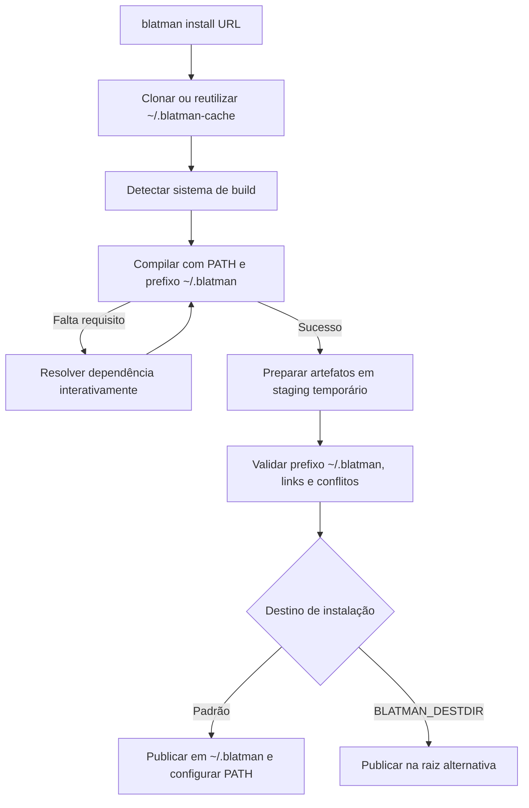

<div align="center">

# ⚡ Blatman

**Do código-fonte à instalação, sem precisar decorar um comando para cada sistema de build.**

Um gerenciador de compilação e instalação para Linux, escrito em **C++20**. O Blatman identifica o sistema de build de um projeto, coordena a compilação e valida os arquivos em staging antes de publicá-los no diretório do usuário.


[Começar](#começando) · [Funcionalidades](#funcionalidades) · [Compatibilidade](#sistemas-de-build) · [Java e memória](#java-e-uso-de-memória) · [Roadmap](#roadmap)

</div>

---

## Por que o Blatman?

Um projeto usa CMake. Outro usa Cargo. O seguinte depende de Maven, Gradle, Meson ou Mach. Compilar cada um à mão exige conhecer ferramentas, argumentos e etapas de instalação diferentes.

O **Blatman** nasceu para oferecer **um fluxo consistente** sobre essas ferramentas — sem tentar substituir seus compiladores, gerenciadores de dependências ou sistemas de build.

```bash
blatman build .
blatman install [https://github.com/apache/commons-codec.git](https://github.com/apache/commons-codec.git)
```

> [!IMPORTANT]
> **Projeto em desenvolvimento.** `build` e `install` são os fluxos implementados. `remove` e `update` ainda **não funcionam**. O Blatman ainda não é um substituto completo de `pacman`, `apt`, `dnf` ou de outros gerenciadores de pacotes.

## Funcionalidades

- **Detecção de dez sistemas de build**, com opção de escolha explícita via `BLATMAN_BUILD_SYSTEM` quando há mais de um manifesto.
- **Build local** por uma interface única (`blatman build <diretório>`).
- **Instalação a partir de repositórios Git HTTPS** no formato `https://host/autor/repositório.git`, com suporte a submódulos.
- **Reutilização de clones em cache** em `~/.blatman-cache/`, com trava contra execuções simultâneas no mesmo repositório.
- **Instalação isolada no usuário (`~/.blatman`)**: pacotes, bibliotecas, headers e dados são publicados em `~/.blatman/{bin,lib,include,share}`, **sem exigir `sudo`** na compilação ou publicação.
- **Ambiente encadeado de build**: ao compilar ou instalar, o Blatman injeta `~/.blatman` em `PATH`, `PKG_CONFIG_PATH` e `CMAKE_PREFIX_PATH` para que dependências recém-instaladas sejam encontradas pelos projetos seguintes.
- **Configuração automática de `PATH`**: em `bash` e `zsh`, adiciona `~/.blatman/bin` ao `~/.bashrc` ou `~/.zshrc` ao instalar na raiz padrão.
- **Staging e transação atômica**: os artefatos são preparados numa árvore temporária, validados contra escapes de prefixo, conflitos e links simbólicos inválidos, com rollback em caso de falha.
- **Resolução interativa de dependências ausentes** a partir de diagnósticos de erro, via gerenciador de pacotes da distribuição (`pacman`, `apt`, `dnf`, `zypper`, `xbps-install`, `brew`) ou outra URL Git HTTPS.
- **Suporte a Java com seleção de JDK**, Maven e Gradle, incluindo perfil econômico de memória por padrão.

## Começando

### Requisitos

- **Linux** e ferramentas de desenvolvimento C/C++ compatíveis com **C++20**.
- **CMake 3.20+**, **Git** e **nlohmann_json 3.6+** (necessário na compilação do Blatman).
- Um compilador C++ e as ferramentas correspondentes ao projeto que será construído (por exemplo: `make`, `meson`/`ninja`, `cargo`, `rustc`, `go`, `npm`/`node`, `mvn`, `gradle`, `autoreconf` ou `python3`).
- **JDK instalado** para projetos Java. O Blatman seleciona uma instalação compatível, mas não baixa nem instala JDKs automaticamente.

> As ferramentas externas de cada ecossistema continuam sendo pré-requisito no ambiente. Maven, Gradle, Cargo, Go, npm e Python não são instalados automaticamente na compilação do Blatman.

### Compilar e instalar o Blatman

```bash
git clone [https://github.com/Blatokkj/blatman.git](https://github.com/Blatokkj/blatman.git)
cd blatman

cmake -S . -B build \
  -DCMAKE_BUILD_TYPE=Release \
  -DCMAKE_INSTALL_PREFIX=/usr \
  -DBUILD_TESTING=OFF

cmake --build build -j2
sudo cmake --install build

blatman help
```

Por padrão, o `CMakeLists.txt` do projeto utiliza `/usr` como prefixo para o binário do próprio Blatman, instalando-o em **`/usr/bin/blatman`**. O `-j2` acima é uma escolha conservadora para máquinas com pouca memória e pode ser ajustado conforme o hardware.

Para conferir qual binário está sendo executado:

```bash
type -a blatman
```

## Uso

> [!NOTE]
> Execute `blatman build` e `blatman install` como **usuário comum** (sem `sudo`). O Blatman recusa executar esses comandos como `root`, pois os pacotes são instalados em `~/.blatman`. Caso o fluxo interativo precise instalar uma dependência do sistema via gerenciador da distribuição, apenas essa etapa solicitará `sudo`.

### Compilar um projeto local

```bash
cd /caminho/do/projeto
blatman build .
```

O Blatman detecta o sistema de build a partir dos arquivos presentes na pasta e invoca a ferramenta correspondente. **Build não significa instalação**: `build` não publica arquivos em `~/.blatman`.

### Clonar, compilar e instalar

```bash
blatman install [https://github.com/apache/commons-codec.git](https://github.com/apache/commons-codec.git)
```

Esse fluxo clona (ou reutiliza) o repositório em `~/.blatman-cache/`, detecta o sistema de build, executa a compilação, prepara os artefatos em staging e os publica em `~/.blatman`:

- Executáveis: `~/.blatman/bin`
- Bibliotecas: `~/.blatman/lib`
- Headers: `~/.blatman/include`
- Dados, manuais e repositórios Maven: `~/.blatman/share`

**Teste em raiz alternativa (`BLATMAN_DESTDIR`):**

```bash
BLATMAN_DESTDIR="$HOME/blatman-test-root" \
  blatman install [https://github.com/apache/commons-codec.git](https://github.com/apache/commons-codec.git)
```

O caminho em `BLATMAN_DESTDIR` precisa ser absoluto. Nesse modo, o Blatman replica a árvore até `<HOME>/.blatman` dentro de `~/blatman-test-root`, sem tocar na sua instalação real nem alterar o `~/.bashrc`/`~/.zshrc`.

### Comandos disponíveis

| Comando | Estado | Descrição |
| --- | --- | --- |
| `blatman build <diretório>` | ✅ Implementado | Compila um projeto local. |
| `blatman install <URL HTTPS>` | ✅ Implementado | Clona/reutiliza, compila e instala em `~/.blatman`. |
| `blatman help` | ✅ Implementado | Exibe a ajuda resumida e as variáveis de ambiente. |
| `blatman remove` | 🚧 Pendente | Ainda não remove pacotes instalados. |
| `blatman update` | 🚧 Pendente | Ainda não atualiza pacotes instalados. |

Atalhos reconhecidos: `-B`/`-b` para build, `-S`/`-i` para install, `-h`/`--help` para ajuda, `-R`/`-r` para remove e `-U`/`-u` para update. **Os atalhos de comandos pendentes também permanecem pendentes.**

### Variáveis de ambiente

| Variável | Descrição |
| --- | --- |
| `BLATMAN_DESTDIR` | Caminho absoluto de uma raiz alternativa para publicação isolada. |
| `BLATMAN_BUILD_SYSTEM` | Força um sistema presente no projeto (`cmake`, `make`, `meson`, `cargo`, `npm`, `maven`, `gradle`, `autotools`, `go`, `mozillamach`). |
| `BLATMAN_JAVA_HOME` | Seleciona explicitamente o diretório de um JDK compatível. |
| `BLATMAN_JAVA_HEAP_MB` | Define o `-Xmx` da JVM entre `256` e `32768` MiB (padrão: `512`). |
| `BLATMAN_JAVA_WORKERS` | Define o número máximo de workers do Gradle entre `1` e `32` (padrão: `1`). |
| `BLATMAN_GO_PACKAGES` | Seleciona pacotes `main` em projetos Go com layout ambíguo. |

## Sistemas de build

O Blatman identifica os sistemas abaixo e possui fluxos de build e preparação de instalação para eles. Isso **não garante** que qualquer projeto desses ecossistemas possa ser instalado: é necessário que a estrutura e as receitas do projeto sejam compatíveis.

| Sistema | Identificação típica | Comportamento principal |
| --- | --- | --- |
| **CMake** | `CMakeLists.txt` | Configura/compila com prefixo `~/.blatman`; instala em staging via `cmake --install` com `DESTDIR`. |
| **Make** | `Makefile`, `makefile`, `GNUmakefile` | Executa `make`; usa alvo `install` com `DESTDIR`/`prefix` ou extrai um executável ELF único do `.DEFAULT_GOAL`. |
| **Meson** | `meson.build` | Configura e compila com `meson`; ajusta diretórios no prefixo `~/.blatman`, valida destinos via `meson introspect --installed` e prepara com `meson install`. |
| **Cargo (Rust)** | `Cargo.toml` | Consulta metadados do workspace (`--locked` quando há `Cargo.lock`), compila binários em release e copia executáveis ELF. |
| **Go** | `go.mod` ou `go.work` | Descobre pacotes principais na raiz e em `./cmd/...` (ou via `BLATMAN_GO_PACKAGES`) e compila os executáveis. |
| **npm** | `package.json` | Executa `npm ci`/`npm install` + `build`, empacota com `npm pack` e instala no staging validando manifesto e links `bin`. |
| **Maven** | `pom.xml` | Executa `package` (priorizando `mvnw`) e publica artefatos num repositório Maven em `~/.blatman/share/maven-repo`. |
| **Gradle** | `build.gradle[.kts]`, `settings.gradle[.kts]` | Executa `build` (priorizando `gradlew`); prepara publicações Maven e distribuições `application` com wrappers em `~/.blatman/bin`. |
| **Autotools** | `configure`, `configure.ac`, `configure.in` | Executa `autoreconf -fi` (se necessário), `./configure --prefix=~/.blatman` e prepara via fluxo Make. |
| **Mozilla Mach** | `mach` e `moz.configure` | Compila com `./mach build`, inspeciona o ambiente JSON (rejeitando alvos Android) e prepara via `./mach install` com `DESTDIR`. |

Se vários sistemas coexistirem no mesmo repositório, use uma escolha explícita:

```bash
BLATMAN_BUILD_SYSTEM=cmake blatman build .
```

## Java e uso de memória

O suporte a Java é pensado também para computadores com recursos limitados. Sem configurar nada, o Blatman utiliza um **perfil econômico** para as ferramentas Java que invoca:

| Parâmetro | Padrão |
| --- | --- |
| Heap inicial da JVM configurada | `64 MiB` (`-Xms64m`) |
| Heap máximo da JVM configurada | `512 MiB` (`-Xmx512m`) |
| Metaspace máximo da JVM configurada | `384 MiB` |
| Coletor de lixo | `SerialGC` |
| Workers do Gradle | `1` |
| Paralelismo entre projetos no Gradle | Desativado (`--no-parallel`) |
| Daemon persistente do Gradle | Desativado (`--no-daemon`) |
| Histórico de saída Java retido pelo Blatman | Até `256 KiB` nas chamadas configuradas |

**Uso normal:**

```bash
blatman build .
```

Para projetos que precisem de mais recursos, os limites podem ser **sobrescritos apenas naquela execução**:

```bash
BLATMAN_JAVA_HEAP_MB=1024 BLATMAN_JAVA_WORKERS=2 blatman build .
```

Para Gradle, o Blatman verifica a versão do wrapper (ou do Gradle instalado) e escolhe um JDK compatível entre `BLATMAN_JAVA_HOME`, `JAVA_HOME`, `PATH` e `/usr/lib/jvm`. Wrappers `gradlew` e `mvnw` têm prioridade quando disponíveis. O download automático de JDK pelo Gradle é desativado e a compilação Kotlin é solicitada **in-process**.

> [!NOTE]
> `-Xmx512m` limita o **heap** da JVM configurada, **não a RAM total** do Maven, Gradle ou de processos filhos. Projetos maiores podem precisar de mais memória; o perfil padrão prioriza previsibilidade em vez de desempenho máximo.

### Validação manual: Apache Commons Codec

Em **20/10/2026**, o fluxo `blatman install https://github.com/apache/commons-codec.git` concluiu a compilação, os testes e a etapa de instalação em versão anterior do ambiente de desenvolvimento do projeto:

- **19.856 testes executados**; **0 falhas**, **0 erros** e **7 ignorados**, conforme a saída do Maven.
- JDK 27 selecionado e opções de heap de `512 MiB` aplicadas ao Maven.
- JARs e artefatos Maven produzidos e publicados em staging antes da instalação final.
- Num notebook com **4 GB de RAM**, foi observada uma leitura de cerca de **2,73 GB de RAM utilizada** durante o processo.

É **um teste manual específico**, não um benchmark reproduzível, uma medição de pico ou uma promessa de compatibilidade com qualquer projeto Java.

## Como funciona a instalação



A etapa de publicação verifica tipos de arquivos, bloqueia permissões especiais (`setuid`/`setgid`), rejeita destinos fora de `~/.blatman`, recusa conflitos já existentes e valida links simbólicos. Se uma cópia falhar no meio da operação, o Blatman executa o rollback dos arquivos e diretórios criados.

Essas verificações **não tornam seguro executar código-fonte desconhecido**: scripts de build, plugins e dependências podem executar código arbitrário durante a compilação. Revise a procedência do projeto antes de instalar.

### Cache Git

Os clones ficam em **`~/.blatman-cache/`**, organizados por servidor, autor e repositório, protegidos por trava de arquivo (`flock`). O cache valida `HEAD`, `remote.origin.url` e submódulos antes de reutilizar um checkout, mas **não executa automaticamente `git pull` ou `git fetch`** para atualizar para commits mais novos.

## Testes e desenvolvimento

O CMake permite compilar a suíte de regressão separadamente:

```bash
cmake -S . -B build \
  -DCMAKE_BUILD_TYPE=Debug \
  -DBUILD_TESTING=ON
cmake --build build -j2
ctest --test-dir build --output-on-failure
```

A suíte registrada no CTest (`tests/regression.py` e `blatman-publication-test`) cobre fluxos de instalação/publicação e verificações offline. Há também scripts específicos para os sistemas de build em `tests/build-system/` (como `detector.py` e `integration.py`), que dependem das ferramentas externas correspondentes e são executados separadamente do CTest.

### Organização do código

```text
blatman/
├── include/                                # Interfaces internas dos módulos
│   ├── operations/
│   │   ├── builder/                        # build, detecção, Java, Meson, Mozilla e workflow
│   │   └── installation/                   # install, transação, dependências e helpers
│   │       ├── base/                       # Caminhos padrão (~/.blatman)
│   │       └── details/                    # Contratos específicos (ex.: Mozilla Mach)
│   └── pkg/                                # Detecção e abstração de gerenciadores do sistema
├── src/
│   ├── main.cpp                            # Entrada CLI e bloqueio de execução como root
│   ├── logger.cpp                          # Registro de logs com timestamp
│   ├── pathSetup.cpp                       # Resolução de HOME e escrita no .bashrc/.zshrc
│   ├── shell.cpp                           # Execução e captura de comandos externos
│   ├── operations/
│   │   ├── help.cpp / remove.cpp / update.cpp
│   │   ├── builder/                        # Implementação dos builders e detector
│   │   └── installation/                   # Staging, parser de requisitos e publicação
│   │       ├── base/
│   │       └── details/                    # Submódulos Meson e Mozilla Mach
│   └── pkg/                                # Suporte a pacman, apt, dnf, zypper, xbps e brew
├── tests/                                  # Suíte de regressão e testes por sistema
└── CMakeLists.txt
```

## Limitações conhecidas

1. **`remove` e `update` ainda não estão implementados.** Ainda não há uma base persistente de pacotes instalados para desinstalação ou atualização.
2. **Clones em cache não são atualizados automaticamente.** Reutilizar um repositório em `~/.blatman-cache/` pode compilar uma revisão anterior caso ele já exista localmente.
3. **Instalação não é sinônimo de build.** Projetos sem receita de instalação compatível podem compilar corretamente e mesmo assim não produzir artefatos instaláveis.
4. **Publicação evita conflitos em vez de sobrescrever arquivos.** Uma reinstalação em `~/.blatman` é recusada se os caminhos de destino já estiverem ocupados.
5. **Resolução de dependências é assistida e parcial.** O Blatman reconhece determinados padrões de erro; não resolve automaticamente qualquer dependência possível.
6. **O alvo atual é Linux.** Não há suporte declarado para Windows ou macOS, nem garantia de compatibilidade com toda distribuição Linux.

## Roadmap

- [x] Interface única para build e instalação a partir de Git
- [x] Detecção de dez sistemas de build (incluindo Mozilla Mach)
- [x] Instalação isolada em `~/.blatman` com configuração de ambiente e `PATH`
- [x] Preparação, validação e rollback de artefatos em staging
- [x] Suporte a Maven/Gradle com perfil econômico de memória
- [x] Testes de regressão e integração
- [ ] Registro e rastreamento dos pacotes instalados
- [ ] Implementar `remove`
- [ ] Implementar `update` (incluindo atualização seletiva)
- [ ] Melhorar a atualização e a política de cache de repositórios
- [ ] Reduzir builds Java redundantes e aprimorar o cache Maven
- [ ] Expandir a suíte automatizada e integrá-la continuamente ao CI
- [ ] Aprimorar o gerenciamento adaptativo de recursos conforme a memória disponível

## Contribuição e feedback

O Blatman é um projeto em evolução. Relatos de problemas devem incluir o comando executado, o sistema de build detectado, a distribuição Linux, a versão da ferramenta externa e os trechos relevantes do erro.

[Abra uma issue](https://github.com/Blatokkj/blatman/issues) ou acompanhe o [repositório](https://github.com/Blatokkj/blatman).

> **Licença:** o repositório ainda não inclui um arquivo `LICENSE`. Não presuma que o código esteja distribuído sob uma licença open-source específica até que uma seja definida.

---

<div align="center">

**Blatman** · Feito em C++ para tornar builds e instalações menos trabalhosos, um projeto de cada vez.

</div>